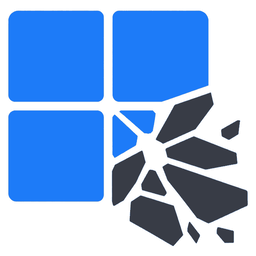
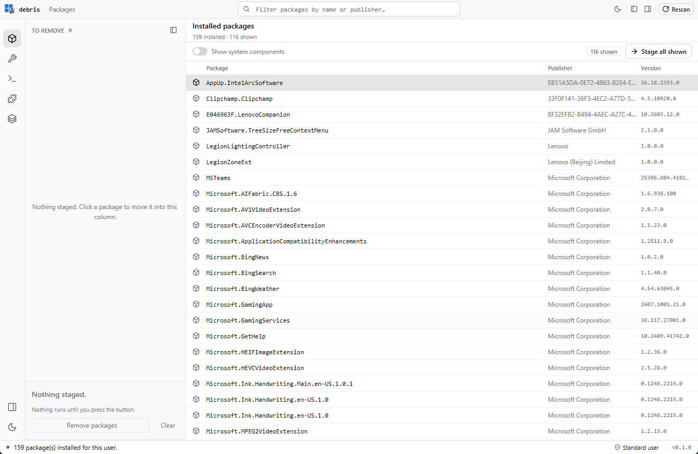
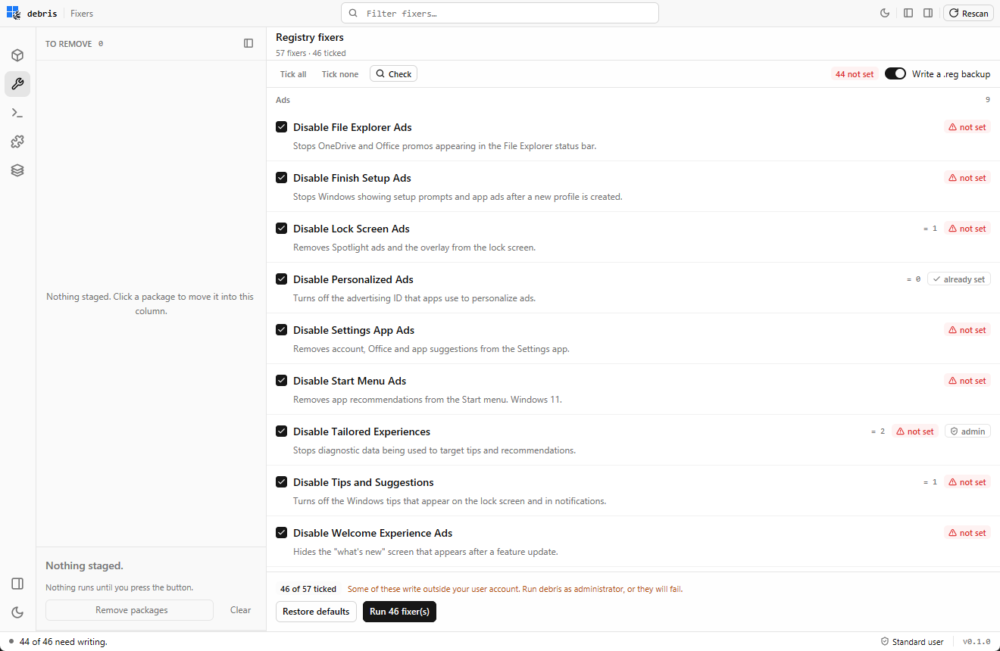
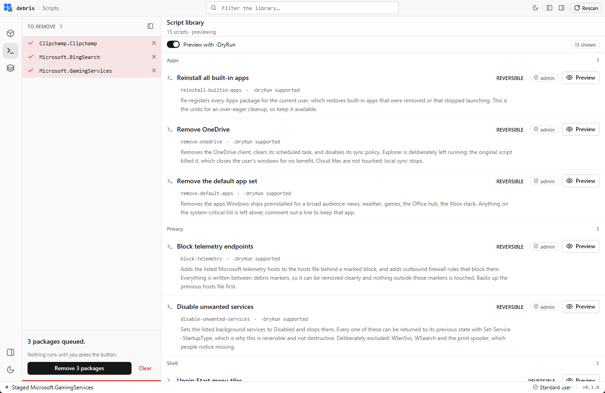

<p align="center">
  
</p>

# debris

A Windows debloat tool in Rust. It does three things:

- **Packages** — the Appx/UWP packages installed for this user, staged for removal.
- **Fixers** — registry rules, each naming the value it wants *and* the value Windows
  ships with. Tick what you want, check it against the registry, run it, and restore it
  to the Windows default.
- **Scripts** — an audited PowerShell library, plus third-party scripts from JSON
  catalogues you add by URL.

## Screenshots

Staging moves a package out of the table and into the queue; nothing runs until you
press Run.



Each rule shows whether the machine already satisfies it, and what it holds right now.
Nothing is written until the ticked set is confirmed.



Every script declares its own risk and whether it needs administrator rights; the
ticked set runs from one footer button.



## Status

Early. Everything above is implemented and tested. Package removal runs the real
`Remove-AppxPackage` command, and a run of fixers writes the registry; both ask for
confirmation first.

## Where your data goes

Nothing is sent anywhere unless you add a catalogue URL and ask for it.

| Path | What |
|---|---|
| `%APPDATA%\debris\settings.json` | Backup toggle, appearance, catalogue URLs |
| `%APPDATA%\debris\fixers\*.json` | Fixers you wrote. Same schema as the shipped catalogue |
| `%APPDATA%\debris\backups\*.reg` | A backup written before each fixer run |
| `%APPDATA%\debris\extensions\` | Installed extension scripts, and the record of them |
| `%LOCALAPPDATA%\debris\scripts\` | The unpacked script library. Regenerable, so it does not roam |

Every file the app reads is JSON. The shipped catalogues are `assets/data/fixers.json`
and `assets/data/bloatware.json`, embedded in the binary at build time.

## Publishing an extension catalogue

An extension is a script this app does not ship. You publish it, list it in a JSON file,
and anyone who adds that file's URL on the **Extensions** surface can see the list,
install a script, and run it after confirming. Nothing is audited on the way in: the
catalogue's own text is what the user reads before deciding, so publish it honestly.

A catalogue is an array, and there are six fields:

```json
[
  {
    "name": "Export network configuration",
    "description": "Writes your addresses, gateways, DNS servers and proxy settings to a text report.",
    "url": "https://raw.githubusercontent.com/d3uceY/debris/main/examples/extensions/export-network-config.ps1",
    "version": "1.0",
    "requiresAdmin": false
  }
]
```

`name` and `url` are required — the URL has to end in `.ps1`, and its last path segment
becomes the installed file's name. An entry that fails either test is dropped on its own,
so one typo in a shared catalogue does not hide everybody else's scripts.

`description` and `version` are shown. `requiresAdmin` (or `requires_admin`) makes the
warnings appear before a run. `sha256` is optional and worth publishing: when an entry
carries one, a download that does not match is deleted rather than installed.

`examples/extensions/` is a working copy of the above: a two-entry catalogue and the two
read-only scripts it points at.
[Its README](examples/extensions/README.md) is the full guide — what an installed script
gets and does not get, why standard output is not shown, how to publish a checksum, and
how to serve a catalogue from your own machine to try it before publishing.

## Architecture

Four crates, one direction of dependency. The UI never touches PowerShell, and the
domain logic never touches the OS — which is what makes the whole thing testable
without running a single destructive thing.

```
crates/
├── debris-core/      domain model + all pure logic         (serde only, no IO)
├── debris-backend/   PowerShell discovery, execution, and the script library
├── debris-ui/        GPUI: theme, icons, components, views (depends on core only)
└── debris-app/       the binary; wires backend and ui together
```

```
debris-app ──► debris-backend ──► debris-core
     └───────► debris-ui ───────► debris-core
```

- **`debris-core`** — `model`, `catalog` (what counts as system-critical), `staging`
  (the two-partition staging model the removal queue is a view of), `tweak` (a registry
  rule and whether the machine satisfies it), `bloat` (what a package *is*), `extension`
  (a catalogue entry), `settings`, `preset`, `script` (the `###` header contract),
  `plan` (turning a staging set into executable steps), `error`. No IO, no
  `std::process`, no GPUI. Everything here is unit-testable in microseconds.
- **`debris-backend`** — the PowerShell boundary, behind one trait. `CommandRunner`
  has a real implementation (spawns `powershell.exe`) plus two test doubles that
  record instead of spawning. Discovery asks PowerShell for **CSV** rather than
  marshalling objects, so parsing is plain, verifiable text handling. A batch of fixers
  is read or written in **one** process, and the decision — applied or not — is made in
  Rust from the values that came back.
- **`debris-ui`** — theme tokens, the SVG icon set, components, and views. Reads
  state through a small `Snapshot` type, so it can render any state without knowing
  where it came from.
- **`debris-app`** — the embedded data (the build script bakes `assets/` and `scripts/`
  into the binary), the asset source, the window, and the controller that owns the state
  and moves work off the render thread.

### The safety model

Four rules, enforced by code and by tests rather than by convention:

1. **Nothing runs implicitly.** Removal, fixers and scripts are only ever triggered by
   an explicit action, and the ticked sets are proposals until then.
2. **Scripts declare themselves.** Every `.ps1` carries a `###` header naming its
   category, risk, whether it needs admin, and whether it supports `-DryRun`. The
   library refuses to mark a script runnable if it declares `risk=destructive`
   without `dry-run=yes`.
3. **Every action is confirmed.** Removal, a ticked set of scripts, a ticked set of
   fixers, a restore, and an extension all open the same dialog, which names what will
   happen and holds the only control that commits.
4. **A fixer names its way back.** Every rule carries the value Windows ships with, so
   "restore" is a fact about the catalogue rather than a promise. A rule whose default
   is the *absence* of a value says so, and restoring deletes it.

`crates/debris-backend/tests/policy.rs` asserts all of this against the real
`scripts/` directory and the real `assets/data/` catalogues, including that every
script parses under PowerShell's own parser. Parse-only, so validation never executes
anything.

## Layout

```
crates/          the four Rust crates
scripts/         the PowerShell library, segmented by intent
  lib/           shared module (logging, elevation checks, dry-run plumbing)
  apps/          remove or restore preinstalled apps
  shell/         Explorer and Start menu
  maintenance/   system housekeeping: cleanup, caches, and resets
assets/
  icons/         the SVG icon set
  data/          fixer catalogue, bloatware catalogue, system-app list, presets
docs/            the screenshots above
examples/        a catalogue template, with two working extension scripts
```

There is no `privacy/` shelf: everything that used to live there is a registry rule, so
the catalogue can describe it, check it, apply it and undo it — which a script could
not.

Both `assets/` and `scripts/` are the source of truth, and both are **embedded into the
binary at build time** — a released exe needs nothing beside it. Only the files the app
actually reads go in, so `assets/debris.ico` (a link-time resource) and
`scripts/README.md` (this repository's own documentation) stay out. The script library is
unpacked to `%LOCALAPPDATA%\debris\scripts\<hash>` on launch: PowerShell runs a script
from a real path, and the shared module is imported through `$PSScriptRoot`.

## Build

Requires Rust 1.85+ and Windows.

```sh
cargo run -p debris-app
```

The first build takes a few minutes — GPUI is a git dependency, so Cargo clones the
Zed repository and compiles on the order of 200 crates. After that it is around a
minute.

## Test

```sh
cargo test --workspace            # unit + policy tests
cargo test --release -p debris-backend --test perf -- --nocapture
```

The policy tests parse the real scripts with PowerShell's parser. **No script is
ever executed by the test suite**, and no test mutates the system.

## Release

Push a tag, and that tag *is* the release:

```sh
git tag v0.1.2
git push origin v0.1.2
```

Nothing computes a version. The workflow reads `v0.1.2` off the tag, stamps `0.1.2` into
`[workspace.package].version`, builds on `windows-latest`, and attaches one file —
`debris.exe` — to a GitHub Release tagged `v0.1.2`. Everything the app reads at runtime is
inside it, so downloading it and double-clicking it is the whole installation: no unzip, no
console window, no data directory beside it. That same `0.1.2` is what the app puts in the
status rail and what Windows shows in the exe's properties, so the tag, the release and the
binary can never disagree.

To release a commit you have not tagged, run **Release → Run workflow** from the Actions
tab and give it a version; the tag is created at the commit the run started from.

Tags must be `v<major>.<minor>.<patch>`. The version in the checked-in `Cargo.toml` is
only what a *local* build calls itself — the release always uses the tag, so there is
nothing to bump before you tag.

Windows is the only target, and GitHub Releases is the only destination: there is no
Homebrew cask, no winget manifest, no update server.

## License

Apache-2.0. See [LICENSE](LICENSE).